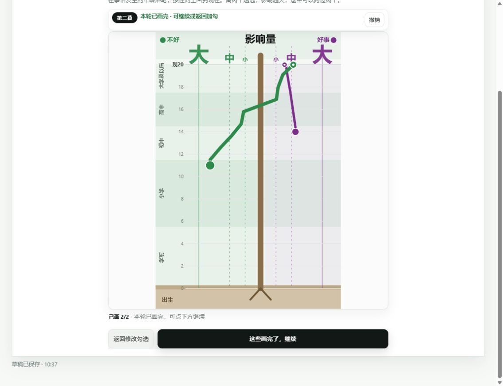
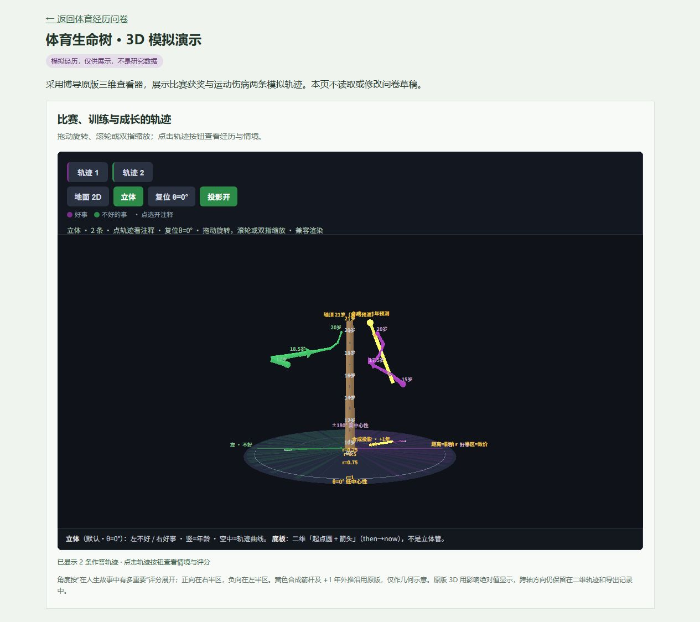

# 生活与体育经历共同生命树 v0.9.1

**当前规则见 [v0.9.1 图中映射说明](../../docs/in_scene_mapping_v0.9.1.md)、[v0.8 原版对齐与交互说明](../../docs/mentor_alignment_v0.8.md) 和 [共同生活史整合方案](../../docs/common_life_history_v0.7.md)。** 一般生活清单现为博导原版 52 条，体育专项另外追加 24 条；年龄与年级使用展开的点击选项，画树前加入原版示范和九宫格一笔练习。下文 v0.6 的无体育经历跳过整棵树规则已被替代：所有学生均可画一般生活树。旧版已选事件、轨迹及原答保留，不会被静默改写为新版题干。

纯本地原型，数据保存在当前浏览器的 localStorage，可下载 JSON，不向服务器提交。

已提供 [GitHub Pages 在线版](https://heyuehua12.github.io/sports-life-tree/) 和 [无需填写问卷的 3D 演示](https://heyuehua12.github.io/sports-life-tree/3d.html)。问卷页首也有“3D 演示”入口。线上只托管静态代码，作答仍保存在浏览器。

## 流程

背景点击选择 → 原版一般生活与新增体育事件勾选/自填 → 标签、去重与排序 → 示范和画线练习 → 自由绘制共同生命树 → 共同情境与条件专项题 → 分领域检查与导出。

清单来自 `reference_notes/mentor-options.js`，教学来自 `reference_notes/mentor-experiment.js`，均为用户提供的只读源码快照。可运行 `node adapt-mentor-catalog.cjs`、`node adapt-mentor-tutor.cjs` 重建适配文件。原版题干、类别、类内顺序和类别对照表逐项测试；不将原版参考权重当作新研究常模。

## 生命树复刻来源

绘图核心提取自用户提供的工作区根目录 `js_timeline-plugin.js` 的 `_draw` 方法；样式来自博导托管版本 [life-timeline v3.6.3](https://jspsych.wjx.cn/web/387589364_3000_LT_wjx_embed_v3.6.3/)。仅修改本地体育研究项目，不修改博导项目。

为使克隆后的项目可重建，已将只读源码快照保存为 `reference_notes/mentor-timeline-plugin.js`；适配脚本从这个仓库内路径读取。

- `mentor-draw.js`：原版绘图核心加本地接入改动。
- `mentor-lt.css`：下载保存的原版完整样式，不直接载入页面。
- `mentor-draw.css`：原样式的局部作用域版本，避免覆盖体育问卷其他页面。
- `adapt-mentor-draw.cjs`：可复现的提取及适配脚本；在本目录运行 `node adapt-mentor-draw.cjs` 重新生成绘图核心及样式。
- `tree-ui.js`：体育事件、草稿、返回及继续按钮的适配。
- `life-tree.js`：原版坐标尺度及本地完成状态检查。

## 与原版保持一致的画法

1. 360 × 540 竖版画布；树干 x=204，出生 y=500，现在 y=64。左绿 `#2D8B4A`，右紫 `#7B2D8B`；保留树根、大地、学段条带、年龄刻度和顶部影响标尺。
2. 影响距离为 `30 × 2^(2r)`，小/中/大为 30/60/120 像素；线宽及端点大小随影响改变。
3. 按勾选顺序逐条画，当前事件置顶，下方预告后续最多三件并显示进度。松手自动进入下一件；已画事件保持各自原色叠加。
4. 落笔锁定所选正负侧。落错侧时钳制到正确侧并提示，途中可跨树干；年龄向上推进，向下回画钳制为相同年龄。
5. 绘制中为灰黑虚线，松手后按事件最初正负属性着色；起点实心、终点有白色中心。跨轴不改变整条线的归属颜色。
6. 原始采样距离至少 2 像素，不平滑；转换为最多 32 个 `[年龄, 有符号影响r]` 点，过长时按弧长抽稀。
7. 撤销删除最后一整条线，随后重画该件。刷新后仍能恢复全部已画线并继续撤销。

## 本地体育项目的适配

- 保留体育事件条目及首次回忆/勾选顺序；用独立 ID 区分文字相同的自填事件。
- 允许 0 件事件和单侧正负经历，不套用原项目“至少四件且正负各一”的数量门槛。
- 所有已选体育事件都必须绘制后才能继续，不只要求画够最低数量。
- 每次松手、撤销都自动保存。中心性和当前显著性移到后续情境页，原有评分保留。
- 使用 SVG 屏幕变换矩阵校准落笔，修正画布受最大高度约束后留白导致的坐标偏移；限制采样在有效年龄区域。取消触摸或丢失指针捕获不保存半笔轨迹。
- 旧版线性尺度轨迹不直接冒充原版轨迹。重画时保存至 `previous_trajectories`；年龄修改后同样需要重画并保留原记录。

## 数据含义和与旧版的差异

新绘图记录 `trajectory_version=3`、`trajectory_age_now`、`path_ar`、端点年龄/影响/侧别、`cross_axis`、`age_cross`、`r_cross`、`draw_ms`、`press_ms`、`path_n`、`path_len` 等；当前 JSON 版本为 `sports-life-tree-prototype-v0.9.1`，练习记录位于 `process.tutor` / `tutor_sessions`，不进入正式事件。

- 保持原版实现：`age_start/age_end` 取整，`path_ar` 年龄精确至 0.1 岁；若结束年龄不晚于开始年龄，`age_end=null`。
- 原版文案指导画到现在，但源码不拒绝提前松手。本次保留该规则，没有额外强制终点到现在；分析不能默认最后一个路径点一定在当前年龄。
- `cross_axis` 按起终侧别是否不同定义，`age_cross/r_cross` 仅在两端异侧时记录首次跨侧的采样点。路径跨过又返回时 `cross_axis=false`，完整变化仍保留在 `path_ar` 中。
- 原版近树干区域的 `rFromX` 有单独分支，与绘制回放使用的指数距离并非处处互逆；本次保留其实现，不能将近树干距离当作线性影响值。
- 事件正负归属来自清单，路径侧别代表相应年龄的影响方向；不能据跨轴直接判定客观结局改善。

## 运行与验证

可直接打开 `index.html`，或访问本地预览 `http://127.0.0.1:8765/`（需已启动本地服务）。不同访问地址的浏览器草稿相互独立。

在本目录运行 `node serve.cjs` 可启动预览服务，同时支持 IPv4/IPv6 本机回环地址，端口 8765。服务只提供静态文件，不接收作答数据。

运行 `node life-tree.test.cjs`：测试直接执行提取后的绘图核心，覆盖原版影响比例、顺序推进、错误侧落笔、年龄单调、32 点上限、跨轴、取消、撤销/恢复、全部事件门槛、单侧/零事件及提前松手规则。

历史 v0.5 绘图版本曾通过浏览器检查：正负事件叠加、跨树干、撤销、恢复等。下图也是该历史版本的交互示例，不是研究数据。v0.8 本轮完成模型、原版清单逐项一致性、真实脚本 DOM 流程、练习失败/重试/取消/键盘/减少动画及核心文字配色对比度测试；因桌面 UI 工具不可用，尚未重新进行真实浏览器视觉检查。

量表仍为接口；尚未接入问卷星正式提交。

## 情境页呈现更新

第四步采用低饱和度的淡绿、淡紫选项及柔和底色。五道滑动题均各占一行，使用带凹槽、刻度、立体推子的原生滑块，支持触控和键盘。原有取值范围和保存字段保持一致；0–1 的题目显示两位小数，0–10 的题目显示一位小数，未回答的事件评分仍显示“未作答”。

## 面向有、无比赛训练经历学生的入口（v0.6）

招募对象为大学生，不按体育专业、队伍身份或是否获奖筛选。体育专业、队伍身份、从小到现在是否参赛、是否有专项训练、参赛者是否获奖分别记录。

| 专项训练 | 体育比赛 | 分组编码 | 体育事件流程 |
| --- | --- | --- | --- |
| 有 | 有 | training_and_competition | 记录愿意回忆的事件，画树并补充情境 |
| 有 | 无 | training_only | 同上，不要求有比赛或获奖事件 |
| 无 | 有 | competition_only | 同上，不要求有长期训练 |
| 无 | 无 | neither | 跳过体育专项清单，仍可记录一般生活并画共同生命树 |
| 未答 | 任意/未答 | unknown | 背景页需补充，不按无经历处理 |

现阶段训练定义：以运动技能或成绩为目标，按明确计划持续训练，含教练、队伍或个人计划训练；仅常规体育课或随意锻炼不计入。比赛包括班级、院系、学校、社区及更高层级比赛。两者均回顾至今，包含已停止的经历；正式方案需固定这一时间窗口和定义。

另外记录最近 7 天活动天数及活动当天平均分钟数（选填）。此项是原型的简短活动记录，不是经过验证的身体活动量表，也不据此推定无训练学生不运动。

没有体育经历、没有回忆起符合条目的事件、暂不愿回答分别编码为 `not_applicable_no_exposure`、`none_recalled`、`prefer_not_to_answer`。后两种情况不能归为无比赛训练组，也不能将缺失事件维度记为 0。有已选事件且背景改成两者都无时，保留草稿并提示核对，不自动删除。

正式版本所有学生都完成相同的心理韧性、焦虑、抑郁量表。当前正式量表尚未接入，无事件分支暂时进入检查导出页，JSON 明确标记 `outcome_scales_status=not_integrated`。不能将这条分支误认为正式调查已完整。

导出的 `exposure` 根据独立背景题生成四组。无参赛者的获奖暴露为结构性零，来源标记 `structural_zero_no_competition`；不能把它解释为参赛但未获奖。旧 `team_athlete` 字段含队伍与训练的混合定义，仅保留原数据，不据此自动填新题；新增 `team_membership` 独立记录队伍身份。

研究比较可先做任一比赛/训练经历与两者都无的比较，再按四组拆分；获奖与未获奖的比较优先在参赛学生内开展。正式暴露测量仍需补充训练年限、频率、时长，以及比赛/奖项层级等，不能用生命树事件数代替训练量或获奖水平。横断面结果解释为关联。

## 纵向拖动排序（v0.6）

当前呈现已更新为横向卡片：桌面双列、窄屏单列，按从左到右再从上到下读取顺序。卡片内的体育关系采用展开的原生单选标签，领域采用紧凑多选标签。拖动判定同时使用横纵坐标，支持同行及跨行排序；前移／后移按钮及四个方向键均可调整先后。原有稳定 ID、回忆顺序、轨迹、情境与自动保存逻辑保持。测试覆盖同行拖动、跨行拖动、取消恢复及左右键调整；浏览器检查桌面双列和 390 px 手机宽度无横向溢出。以下为早期纵向版本的记录。

- “已选顺序”现为纵向列表，支持左侧手柄拖动、上移/下移按钮、手柄上的上下方向键。鼠标和触屏均使用 Pointer Events，只有手柄限制滚动，正文仍可正常浏览。
- `select_order` 和数组顺序代表调整后的发生/绘图顺序。`recall_order` 与 `recall_log` 保留首次选择记录，移除后重新勾选同一条目不重置首次次序；`order_history` 记录实际调整。原型中勾选次序只是首次回忆顺序的代理，不代表真实回忆全过程。
- 旧草稿没有原始回忆记录时，按升级时的现有顺序建立快照，并标记 `legacy_snapshot`，不能当作已直接观察的首次回忆。
- 拖动及按钮操作自动保存，刷新恢复；已画轨迹和情境评分按稳定事件 ID 保留。对已完成轨迹的撤销仍按原绘制顺序处理。
- 新增验证：`node study-model.test.cjs`，覆盖四类分组、未答与无经历、获奖结构性零、排序和回忆记录独立、删除/重新选择、刷新数据及旧草稿来源。浏览器已验证拖动、按钮、键盘排序、刷新恢复、画树顺序、无经历跳转和 390 像素宽布局。

## 事件补充与生命树图标

事件清单现有 24 项，正负各 12 项，分为“比赛、选拔与机会”“训练、身体与学业”“关系、支持与归属”。新增参与训练、康复回归、体能改善、资源机会、自主选择、学训协调与获得认可等正向事件，以及训练过载、学训冲突、转队退出、排斥、不公平、被迫参与和身体要求施压等负向事件。原有 10 个条目的稳定 ID 保留，正负两栏仍可自填。

条目在 `event-catalog.js` 中独立维护，后续可继续补充；它们是原型候选事件提示，不是经过验证的量表。只勾选实际发生且愿意记录的事件，不要求每类选满或正负各选一项。事件起初的正负感受与后来影响的方向分开处理。

`StudyModel.canDraw` 按是否有已选事件控制生命树和情境入口，所有学生均可记录一般生活史。没有比赛和专项训练时不开放体育专项清单；背景与旧体育事件冲突时提示核对并保留原数据。没有事件时跳过画树和情境，正式心理量表的接入状态保持可见。

`assets/life-tree.svg` 是原创可缩放矢量标识：纵向树干表示时间，根部连接生活基础，左绿右紫枝条和圆点表示不同事件及其影响。图标已用于页首和浏览器标签页，配色与绘图区域一致。

本轮验证：`node --check app.js` 和 `node study-model.test.cjs` 通过；独立 localhost 测试页已验证 24 项显示、新增条目选择、正负两栏自填、进入排序列表、无经历时禁用轨迹/情境、有旧事件时提示核对、零事件跳过至检查，以及 390 像素宽度无横向溢出。图标正常加载，控制台无错误或警告。测试未修改 127.0.0.1 上的用户作答。

## 3D 生命树汇总

来源为博导公开的 [NRLab 生命树三维结果 v3.5](https://zhenghui.fun/tools/life-tree-viz)。已保存原始 HTML 快照至 `reference_notes/mentor-3d-reference.html`；`adapt-mentor-3d.cjs` 将其生成到 `mentor-3d/index.html`，`mentor-3d/SOURCE.json` 记录来源及 SHA-256。Three.js 0.160.0、OrbitControls、官方 SVGRenderer/Projector 和 MIT 许可均保存到 `vendor/three/`，查看器无需 CDN。请通过本地 HTTP 服务打开，直接双击 file:// 页面无法可靠加载 ES modules。

直接复用原版 Three.js 圆柱树干、变粗轨迹、年龄浮标、r² 显示尺度、中心性角度、相机旋转/巡航、地面 2D/立体切换、投影开关、事件 Q/F 注释、黄色合成向量及 +1 年外推。外推仅为原版几何示意，不作为体育研究的预测模型或量表结果。原版 3D 使用 |r|，固定按事件效价半区展示，不能从它判断跨轴变化；完整有符号路径仍留在二维树及 JSON。

`life-tree-3d.js` 只做本地同源数据桥接，检查页展示当前已完成且年龄一致的轨迹，不向外部站点发送作答。不展示原版示例作为被试数据。情境字段按原答和博导字典映射；角度优先使用中心性，未评分时用可适用的原条目参考权重，两者缺失时按半区中线占位并说明。字典码不是本研究已验证的常模。

本地适配去除站点导航、改为本地依赖、调整 iframe 控件布局、增加同源桥接、转义注释中的自填文本，并修正原版将 r=0 错当缺失值 0.5 的代码（保留 0.05 的最小显示幅度）。保留原版相机朝向，再按容器边界适配取景距离，避免嵌入后树冠和底板被裁切。不改博导的源快照。

支持 WebGL 的浏览器使用原版 WebGLRenderer。当前内置浏览器禁用了 WebGL，自动使用 Three.js 官方 SVGRenderer 绘制同一套三维网格、坐标和相机，仍支持拖动旋转、缩放和事件按钮；年龄浮标改用投影文本。兼容模式的材质效果、虚线效果与 WebGL 有差异，不能视为像素级一致。静止时不重复生成 SVG，减少资源占用。当前浏览器实际验证的是兼容模式，未声称已验证其 WebGL 分支。

运行 `node adapt-mentor-3d.cjs` 可重新生成；`mentor-3d/index.html` 独立打开显示明确标记的原版四条典型演示，问卷中的嵌入模式只显示当前作答。没有体育专项经历者的一般生活轨迹同样可展示；零事件和未完成的旧轨迹不触发 3D。

`life-tree-3d-demo.html` 提供一条一般生活和两条体育模拟经历，使用与问卷相同的数据桥接，不读取或修改草稿。[本地体育 3D 演示](http://127.0.0.1:8765/life-tree-3d-demo.html)。

本轮验证：`node life-tree-3d.test.cjs`、`node study-model.test.cjs` 和 `node --check app.js` 通过；自动核对七个原版几何/相机函数保留、当前年龄与完成路径筛选、零中心性、注释原答接入、草稿不变及模块语法。浏览器走通独立 localhost 测试草稿的“训练经历→选择两项事件→实际绘图→情境→检查页显示两条 3D 轨迹”，并验证无经历时不显示 3D、旋转、复位、地面/立体切换、投影开关、原版和体育注释。390 像素宽度下外页及 iframe 无横向溢出，详情可打开；控制台无错误或警告。未修改 127.0.0.1 用户草稿，localhost 里的轨迹为交互测试数据。

